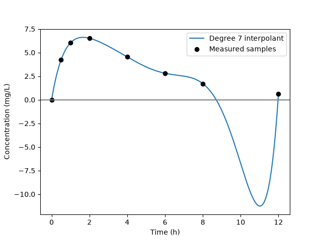
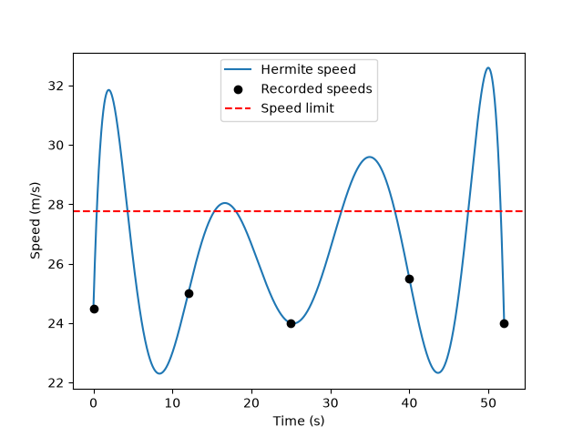

# Assignment 3 - Numerical Analysis

## Group Members

| Name | Roll No. | Part |
|---|---|---|
| Abdul Ahad | 33478 | Problem 1 (lagrange.py), report |
| Nayab Mahmood | 33427 | Problem 2 (newton_differences.py), report |
| Emaan Shahbaz | 31777 | Problem 3 (hermite.py), report |
| Arham Shah | 33459 | Problem 4 (interpolate.py), report |
| Muhammad Rufile Wasim | 33465 | Problem 5 Applications A, B, C and D, report |

Each file can be run on its own with `python <filename>.py` and it prints the test cases for that problem. We only used numpy, matplotlib and sympy. Also everyy memeber played a part in the report, specifically corresponding to their problems they answered.


## Problem 1 - Lagrange Interpolation

### (i) Kronecker property

The L_k(x_j) matrix came out as the identity (max deviation 0.0), and the sum of the L_k(x) stayed within 6.66e-16 of 1 on a fine grid.

The sum has to be 1 because if f(x) = 1, the interpolant is just the sum of the L_k(x). The constant 1 already goes through every point, and the interpolating polynomial is unique, so the sum must be 1 everywhere.

### (ii) Exactness

With f(x) = 2x^3 - x + 5 and nodes -1, -0.2, 0.4, 1, the max error was 3.55e-15. It's exact because f is a cubic and 4 nodes give a unique polynomial of degree 3, so the interpolant is f itself. The leftover error is just round-off.

### (iii) Runge phenomenon

| n | Equally spaced (max error) | Chebyshev (max error) |
|---|---|---|
| 5 | 0.43269231 | 0.55591134 |
| 10 | 1.91564305 | 0.10915327 |
| 15 | 2.10755185 | 0.08310705 |
| 20 | 59.82230871 | 0.01533292 |


With equally spaced nodes the error near the ends grows as n goes up. Chebyshev nodes are packed closer near the ends, so the error stays small.


## Problem 2 - Newton Forward and Backward Differences

Difference table for e^x with spacing h = 0.2:

```text
       x         y  Delta^1 y  Delta^2 y  Delta^3 y  Delta^4 y  Delta^5 y
0.000000  1.000000   0.221403   0.049019   0.010853   0.002403   0.000532
0.200000  1.221403   0.270422   0.059872   0.013256   0.002935
0.400000  1.491825   0.330294   0.073128   0.016191
0.600000  1.822119   0.403422   0.089319
0.800000  2.225541   0.492741
1.000000  2.718282
```

### (i) Accuracy vs. degree

| Degree | e^0.05 (forward) | True error | Error estimate | e^0.95 (backward) | True error | Error estimate |
|---|---|---|---|---|---|---|
| 1 | 1.0553506895 | 4.079593e-03 | 4.595548e-03 | 2.5950966035 | 9.386944e-03 | 8.373635e-03 |
| 2 | 1.0507551413 | 5.159551e-04 | 5.935225e-04 | 2.5867229686 | 1.013309e-03 | 8.854314e-04 |
| 3 | 1.0513486637 | 7.756737e-05 | 9.034266e-05 | 2.5858375372 | 1.278778e-04 | 1.103448e-04 |
| 4 | 1.0512583211 | 1.277530e-05 | 1.500159e-05 | 2.5857271924 | 1.753306e-05 | 1.500159e-05 |

The error estimate is the first term left out. Since the differences shrink quickly for e^x, the estimate is close to the true error.

### (ii) Same polynomial, two formulas

With all 6 nodes, the max difference between the two formulas on 200 points was 1.33e-15. They're the same polynomial written differently, so the difference is just rounding.

With degree 2 the max difference was 2.02e-03, because forward and backward use different sets of 3 nodes, so they build different quadratics.


## Problem 3 - Hermite Interpolation

### (i) Is derivative information worth it?

| Method | Points used | Degree | Error at x = 0.25 | Max error |
|---|---|---|---|---|
| Lagrange | 3 | 2 | 1.226969e-02 | 1.442066e-02 |
| Hermite | 3 + derivatives | 5 | 4.901155e-06 | 5.577330e-06 |
| Lagrange | 6 | 5 | 6.021960e-07 | 2.655070e-06 |

Hermite and 3-point Lagrange use the fewest points (3). Six-point Lagrange was the most accurate. Hermite gets degree 5 from only 3 points, so its error is divided by 6! instead of 3!, which is why it beats 3-point Lagrange by a lot. Six-point Lagrange also has 6!, and here it came out slightly better.

### (ii) Interpolation conditions

Both H(x_i) - f(x_i) and H'(x_i) - f'(x_i) were 0 at all three nodes.

### (iii) Exactness

The max error was 6.66e-16 for x^5 - 3x^2 + 1 and 2.31e-03 for x^6. Hermite on 3 nodes is exact up to degree 5, so x^5 works but x^6 doesn't (its 6th derivative is 720, not 0).


## Problem 4 - Choosing the Method

| Case | x_eval | Predicted | Program chose | Result | True value |
|---|---|---|---|---|---|
| T1 | 0.4 | Newton forward | Newton forward | 0.374011 | 0.389418 |
| T2 | 4.7 | Newton backward | Newton backward | -1.005959 | -0.999923 |
| T3 | 1.5 | Lagrange | Lagrange | 0.996539 | 0.997495 |
| T4 | 1.5 | Hermite | Hermite | 0.997495 | 0.997495 |
| T5 | 0.4 | Newton forward | Newton forward | 0.374011 | 0.389418 |
| T6 | 0.15 | Newton forward | Newton forward | 0.149438 | 0.149438 |
| T7 | 6.5 | Newton backward | Newton backward | 0.384199 | 0.215120 |

All our predictions matched what the program chose. T5 gives the same result as T1 since the nodes get sorted first. T7 has a big error because 6.5 is outside the data, so it's extrapolating.

Why bother choosing? Newton lets you use only a few nearby points instead of all of them, and it gives an error estimate for free from the next term. Adding a new point is also easier in Newton since you just add a term.

Hermite is checked first because if we have derivatives, it would be a waste not to use them. It gives a higher degree without needing more points.

For T6 the gaps are only off by about 1e-9, which is just rounding, so treating it as equally spaced is fine (the program used Newton forward, error about 3.5e-07). If spacing_rtol is too tight, data like this gets rejected for no real reason. If it's too loose, uneven data gets treated as even and Newton gives wrong answers.


## Problem 5 - Applications

### A: Census Population

choose_method picked forward for 1955 and backward for 2015, which makes sense since the years are equally spaced and 1955 is at the start, 2015 at the end.

Difference table:

```
     x      y  Delta^1 y  Delta^2 y  Delta^3 y  Delta^4 y  Delta^5 y  Delta^6 y  Delta^7 y
1950.0  151.3       28.0       -4.0        3.2       -3.4       15.1      -54.2      137.4
1960.0  179.3       24.0       -0.8       -0.2       11.7      -39.1       83.2
1970.0  203.3       23.2       -1.0       11.5      -27.4       44.1
1980.0  226.5       22.2       10.5      -15.9       16.7
1990.0  248.7       32.7       -5.4        0.8
2000.0  281.4       27.3       -4.6
2010.0  308.7       22.7
2020.0  331.4
```

The higher differences are irregular. They flip sign and get bigger instead of shrinking, unlike e^x. So a high degree won't help, and degree 2 to 3 makes more sense.

| Year | Method | Estimate (millions) | Error estimate |
|---|---|---|---|
| 1955 | Forward, degree 3 | 166.00 | 0.1328 |
| 2015 | Backward, degree 3 | 320.57 | 0.6523 |

### B: Steam Table

choose_method picked forward for 25 °C and backward for 55 °C, which we agree with.

| Degree | P(25) kPa | Rel. error | Error estimate | P(55) kPa | Rel. error | Error estimate |
|---|---|---|---|---|---|---|
| 1 | 3.2931 | 0.038883 | 0.153813 | 16.1495 | 0.024519 | 0.328512 |
| 2 | 3.1392 | 0.009642 | 0.037387 | 15.8210 | 0.003679 | 0.049962 |
| 3 | 3.1766 | 0.002153 | 0.007859 | 15.7710 | 0.000509 | 0.007859 |
| 4 | 3.1688 | 0.000326 | none | 15.7632 | 0.000011 | none |

Degree 4 uses every point, so there's no error estimate.


The curve bends upward, so a straight line between two points sits above it, which is why linear overestimates (3.2931 vs 3.1698 at 25 °C). For a pressure vessel that's the safer error, since it means a thicker wall.

We'd recommend 4 terms (degree 3). The error is already under 0.25%, and you still get an error estimate.

### C: Drug Concentration

choose_method picked Lagrange, and we agree.

(a) The sample times aren't equally spaced, so the Newton formulas can't be used.

(b) C(3 h) = 5.6694 mg/L

(c)



It goes negative from about 8.71 h to 11.98 h, down to -11.26 mg/L at 11.02 h. That's impossible for a concentration. The degree 7 polynomial wiggles in the big gap between 8 and 12 h, so using all the points blindly isn't a good idea.

(d)

| Interpolant | Peak concentration (mg/L) | Time of peak (h) |
|---|---|---|
| Degree 7 (all points) | 6.6101 | 1.657 |
| Quadratic through t = 1, 2, 4 | 6.5160 | 1.993 |

Both put the peak around 6.5 to 6.6 mg/L at about 1.7 to 2 hours. The quadratic only uses points near the peak, so we trust it a bit more.

### D: Was the Car Speeding?

The speed limit is 27.78 m/s.

| Interval | Average speed (m/s) |
|---|---|
| 0 to 12 s | 26.00 |
| 12 to 25 s | 26.38 |
| 25 to 40 s | 27.13 |
| 40 to 52 s | 26.33 |

All the recorded and average speeds are under the limit, so going by these alone the driver wouldn't be fined.

choose_method picked Hermite, which makes sense since we have both position and speed at each checkpoint.

| t (s) | Position (m) | Speed (m/s) |
|---|---|---|
| 18 | 475.16 | 27.78 |
| 33 | 862.59 | 28.97 |
| 46 | 1201.94 | 24.49 |



The interpolated speed peaks at 32.60 m/s at t = 50 s and goes over the limit four times (around 0.4-4.3 s, 15.4-18 s, 31.4-38.2 s and 47.5-51.6 s).

We don't think that's enough to fine the driver. The curve swings between 22 and 32.6 m/s even though every recorded speed is 24 to 25.5, which looks like the same wiggling as in Application C. The 25-40 s stretch is the only believable one since the average there is already 27.13 m/s, but it's still an interpolated curve, not a measurement.


## Design Decisions

Two nodes count as the same if they differ by less than 1e-12 (relative), and the error message says which value is repeated.

We set spacing_rtol to 1e-9. Nodes count as equally spaced if no gap differs from the average gap by more than this (relative).

For the base node in Newton forward, we use the closest node at or before x that still has enough nodes after it. Newton backward uses the closest node at or after x that still has enough nodes before it.

H'(x) is found by differentiating the nested (Horner) form step by step, using the product rule at each step. No finite differences are used.


## Method-Selection Summary

If derivatives are given, use Hermite. If not and the points are equally spaced, use Newton forward for x in the first half of the table and Newton backward for the second half. Otherwise use Lagrange. Also avoid using too many points at once, and be careful outside the data range.


## Limitations

High-degree polynomials oscillate (the Runge phenomenon), and the code doesn't warn about this.

Data that is very slightly uneven goes to Lagrange even when Newton would have been fine.

Hermite with many nodes ends up with a very high degree and can oscillate.

The error bound needs a bound on the derivative, which usually isn't known for real data.


## AI Usage Declaration

| Tool used | Part of assignment | What it helped with | % AI-assisted |
|---|---|---|---|
| Claude| report | Building the skeleton of the report | 60% |
| Claude| report | Formatting the report to make it look cleaner | 40% |
| Claude| lagrange | explained how Lagrange basis polynomials work, and why the sum of L_k(x) is 1 | 18% |
| Claude| lagrange | debugging errors and understanding why somee warnings were popping up | 10% |
| Claude| newton differences | understanding forward vs backward differences, and what s and t mean | 10% |
| Claude| newton differences | understadning the base-node rule | 20% |
| Claude| hermite | understanding doubled nodes | 20% |
| Claude| hermite | understanding the exact H′ step and the results using the two error formulas | 20% |
| Claude| applications | understanding how to make the figures | 30% |
| Claude| applications | Help with debugging withh plots and also why warning labels keep popping up  | 32% |
| Claude| interpolate | understanding sorting, extrapolation detection and the spacing tolerance | 30% |
| Claude| interpolate | understanding T6, the tolerance being too tight or too loose, and why Hermite goes first | 27% |