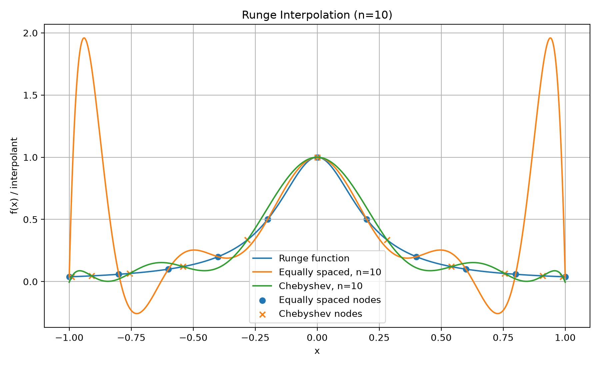
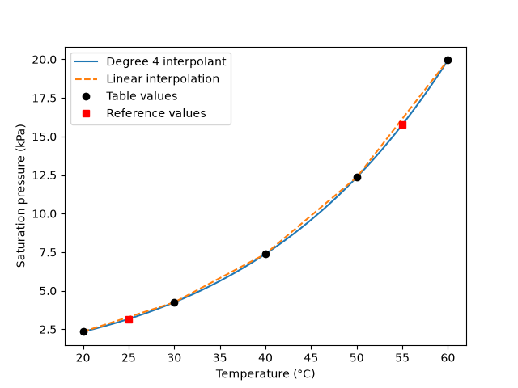

# Assignment 3 - Numerical Analysis

## Group Members

| Name | Roll No. | Part |
|---|---|---|
|Abdul Ahad |33478 | Problem 1 (lagrange.py) |
|Nayab mahmood |33427 | Problem 2 (newton_differences.py) |
|Emaan Shahbaz |31777 | Problem 3 (hermite.py) |
| | | Problem 4 (interpolate.py), Applications A and B |
| | | Applications C and D, report |

To run: `python <filename>.py`. Each file runs its own test cases. Libraries used: numpy, matplotlib, sympy.

---

## Problem 1 - Lagrange Interpolation

**(i) Kronecker property**

L_k(x_j) gives a 4x4 matrix. Max deviation from the identity matrix: 0.0000000000000000

Max deviation of (sum of all L_k(x)) from 1 on a fine grid: 6.661338147750939e-16

Why the sum is always 1: if f(x) = 1, every y value is 1, so the interpolant is just the sum of the L_k(x). The constant 1 is a polynomial of degree 0, and the interpolating polynomial is unique, so the sum must equal 1 everywhere.

**(ii) Exactness**

f(x) = 2x^3 - x + 5, nodes used:[-1.0, -0.2, 0.4, 1.0]

Max error: 3.552713678800501e-15

Why it's exact: f is a cubic and 4 nodes give a unique polynomial of degree 3 or less, so the interpolant is f itself. The 4th derivative of f is 0, so the error formula gives 0. The only error left is round-off.

**(iii) Runge phenomenon**

| n | Equally spaced (max error) | Chebyshev (max error) |
|---|---|---|
| 5 | 0.43269231 | 0.55591134 |
| 10 | 1.91564305 | 0.10915327 |
| 15 | 2.10755185 | 0.08310705 |
| 20 | 59.82230871 | 0.01533292 |



With equally spaced nodes, the error grows near the ends of the interval as n increases. Chebyshev nodes are packed closer together near the ends, which keeps the error small.

---

## Problem 2 - Newton Forward and Backward Differences

Difference table for \(e^x\) with spacing \(h = 0.2\).

```text
       x         y  Delta^1 y  Delta^2 y  Delta^3 y  Delta^4 y  Delta^5 y
0.000000  1.000000   0.221403   0.049019   0.010853   0.002403   0.000532
0.200000  1.221403   0.270422   0.059872   0.013256   0.002935
0.400000  1.491825   0.330294   0.073128   0.016191
0.600000  1.822119   0.403422   0.089319
0.800000  2.225541   0.492741
1.000000  2.718282
```

**(i) Accuracy vs. degree**

| Degree | \(e^{0.05}\) (forward) | True error | Error estimate | \(e^{0.95}\) (backward) | True error | Error estimate |
|---:|---:|---:|---:|---:|---:|---:|
| 1 | 1.0553506895 | 4.079593e-03 | 4.595548e-03 | 2.5950966035 | 9.386944e-03 | 8.373635e-03 |
| 2 | 1.0507551413 | 5.159551e-04 | 5.935225e-04 | 2.5867229686 | 1.013309e-03 | 8.854314e-04 |
| 3 | 1.0513486637 | 7.756737e-05 | 9.034266e-05 | 2.5858375372 | 1.278778e-04 | 1.103448e-04 |
| 4 | 1.0512583211 | 1.277530e-05 | 1.500159e-05 | 2.5857271924 | 1.753306e-05 | 1.500159e-05 |

I calculated the true error as the absolute difference between the interpolated value and \(e^x\). The error estimate is the magnitude of the first omitted term. The higher-order differences shrink quickly for these data, so the estimate is close to the true error. It slightly overestimates the forward errors and slightly underestimates the backward errors.

**(ii) Same polynomial, two formulas**

I compared both formulas on 200 equally spaced points in \([0,1]\).

**All 6 nodes (degree 5)** — The maximum difference was **1.332268e-15**. Both formulas represent the same unique polynomial of degree at most five through the six data points. The small difference comes from floating-point rounding.

**Degree 2** — The maximum difference was **2.023383e-03**. Each formula uses three consecutive nodes. The forward formula starts at its base node, and the backward formula ends at its base node. The two formulas can therefore use different sets of three nodes at the same evaluation point, giving different local quadratics.

---

## Problem 3 - Hermite Interpolation

**(i) Is derivative information worth it?**

| Method | Points used | Degree | Error at x = 0.25 | Max error |
|---|---|---:|---:|---:|
| Lagrange | 3 | 2 | 1.226969e-02 | 1.442066e-02 |
| Hermite | 3 + derivatives | 5 | 4.901155e-06 | 5.577330e-06 |
| Lagrange | 6 | 5 | 6.021960e-07 | 2.655070e-06 |

**Fewest measurement locations.** Three-node Lagrange and Hermite both use 3 points.

**Most accurate.** Lagrange with 6 points had the lowest error at x = 0.25 and on the grid.

**Why.** Hermite uses the derivatives to get a degree 5 polynomial from just 3 points. Its error formula has 6! in the denominator, while three-point Lagrange has 3!. Hermite also has squared \((x-x_i)\) terms, which make the error small near the nodes. Six-point Lagrange also has 6! in the denominator, and its six node factors gave a smaller error in this example.

**(ii) Interpolation conditions**

Max error in \(H(x_i)\) vs. \(f(x_i)\) = **0**

Max error in \(H'(x_i)\) vs. \(f'(x_i)\) = **0**

So Hermite matched both the function value and the slope at all three nodes.

**(iii) Exactness**

Max error for \(x^5-3x^2+1\) = **6.661338e-16** (rounding error)

Max error for \(x^6\) = **2.314806e-03**

**Why.** Hermite with 3 nodes can reproduce any polynomial of degree 5 or less. The sixth derivative of \(x^5-3x^2+1\) is zero, so the result is exact. For \(x^6\), the sixth derivative is 720, so there is still an error between the nodes.

## Problem 4 - Choosing the Method

| Case | x_eval | Predicted | Program chose | Result | True value |
|---|---|---|---|---|---|
| T1 | 0.4 | Newton forward | | | |
| T2 | 4.7 | Newton backward | | | |
| T3 | 1.5 | Lagrange | | | |
| T4 | 1.5 | Hermite | | | |
| T5 | 0.4 | Newton forward | | | |
| T6 | 0.15 | | | | |
| T7 | 6.5 | Newton backward | | | |

Cases where the prediction and the program disagree: ____

**Why bother choosing if all methods give the same polynomial?**
- Newton lets you use just a few nearby points (low degree), which avoids wild oscillation.
- Newton gives a free error estimate from the next term.
- Adding a new data point in Newton just adds one term. Lagrange has to be rebuilt.
- Newton is cheaper to evaluate once the difference table is built.

**Why is Hermite checked first?**
Derivatives are extra information that the other methods would throw away. Hermite uses them to get a higher degree, and usually a smaller error, without needing more data points.

**T6: equally spaced or not?**
The spacing differs by about 1e-9, which is basically rounding noise, so treating it as equally spaced is fine. Our program chose: ____
- Tolerance too tight: real data with tiny rounding errors gets rejected.
- Tolerance too loose: uneven data gets treated as even, and Newton gives wrong answers without any warning.

---

## Problem 5 - Applications

### A: Census Population

Method chosen: ____. Agree? ____

Difference table:

```
(paste output here)
```

The higher differences are ____ (smooth or irregular). Irregular differences mean a high degree won't help, so a low degree (2 to 3) is sensible.

| Year | Method | Estimate (millions) |
|---|---|---|
| 1955 | Forward, degree 3 | |
| 2015 | Backward, degree 3 | |

### B: Steam Table

Method chosen: ____. Agree? ____

| Degree | P(25) kPa | Rel. error | Error estimate | P(55) kPa | Rel. error | Error estimate |
|---|---|---|---|---|---|---|
| 1 | | | | | | |
| 2 | | | | | | |
| 3 | | | | | | |
| 4 | | | | | | |



The curve bends upward, so a straight line between two points sits above it. That's why linear interpolation overestimates.

An overestimate is the safer error for a pressure vessel, because it leads to a thicker wall.

Recommended number of terms: ____

### C: Drug Concentration

Method chosen: ____. Agree? ____

(a) The sample times are not equally spaced, so the Newton formulas can't be used.

(b) C(3 h) = ____ mg/L

(c)


Goes negative? ____ Where: ____ Lowest value: ____ mg/L

A negative concentration is impossible. The degree-7 polynomial is forced through all 8 points and wiggles in the big gaps between samples. Using all the data in one high-degree polynomial isn't always a good idea.

(d)

| Interpolant | Peak concentration (mg/L) | Time of peak (h) |
|---|---|---|
| Degree 7 (all points) | | |
| Low degree (points near the peak) | | |

### D: Was the Car Speeding?

Speed limit = 27.78 m/s

| Interval | Average speed (m/s) |
|---|---|
| 0 to 12 s | 26.00 |
| 12 to 25 s | 26.38 |
| 25 to 40 s | 27.13 |
| 40 to 52 s | 26.33 |

All recorded speeds (24.0 to 25.5 m/s) and all average speeds are under the limit, so based on these numbers alone the driver would not be fined.

Method: Hermite, because we have both the position and the speed (derivative) at each checkpoint.

| t (s) | Position (m) | Speed (m/s) |
|---|---|---|
| 18 | | |
| 33 | | |
| 46 | | |


Max speed from the interpolated curve: ____ m/s at t = ____ s.

Conclusion: ____

---

## Design Decisions

- **Node tolerance:** two nodes count as the same if they differ by less than 1e-12 (relative). The error message names the repeated value.
- **Spacing tolerance (spacing_rtol):** 1e-9. Nodes count as equally spaced if no gap differs from the average gap by more than this (relative).
- **Base node in Newton:** forward uses the closest node at or before x that still has enough nodes after it. Backward uses the closest node at or after x that still has enough nodes before it.
- **Computing H'(x):** found by differentiating the nested (Horner) form step by step, using the product rule at each step. No finite differences are used.

---

## Method-Selection Summary

1. Derivatives given? Use **Hermite**.
2. Otherwise, are the points equally spaced?
   - Yes, and x is in the first half of the table: use **Newton forward**.
   - Yes, and x is in the second half of the table: use **Newton backward**.
3. Not equally spaced: use **Lagrange**.

Tips: don't use too many points at once (high degree causes wiggles), and be careful evaluating outside the data range.

---

## Limitations

- High-degree polynomials oscillate (Runge phenomenon). The code doesn't warn about this.
- Data that is very slightly uneven goes to Lagrange even when Newton would be fine.
- Hermite with many nodes gets a very high degree and can oscillate.
- The error bound needs a derivative bound, which is usually unknown for real data.

---

## AI Usage Declaration

| Tool used | Part of assignment | What it helped with | % AI-assisted |
|---|---|---|---|
| chatgpt | start | understanding question and learning python concepts | |
